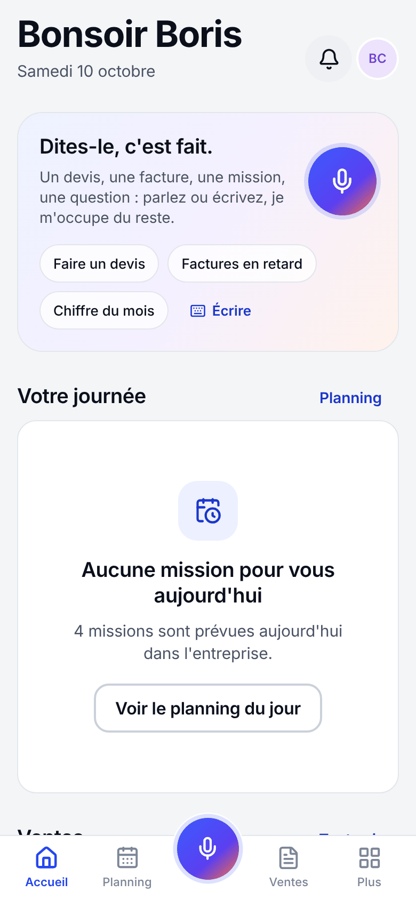
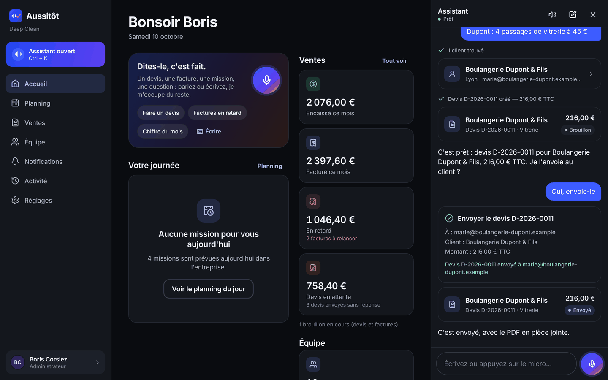

# Aussitôt

**Aussitôt dit, aussitôt fait.** Logiciel de gestion pour les TPE et PME de services (propreté, entretien, multiservices) : devis, factures, planning et équipe, pilotables **à la voix ou par écrit** grâce à un assistant qui comprend la demande et agit dans l'application.

> « Fais un devis pour la boulangerie Dupont : 4 passages de vitrerie à 45 € » → le devis est créé ; « Envoie-le » → l'assistant demande confirmation, puis l'envoie au client avec le PDF.

Aussitôt est vendu à **plusieurs entreprises** (SaaS multi-entreprises) : chacune a ses comptes, ses données, son logo et sa couleur sur ses documents, sans jamais voir celles des autres. L'architecture est pensée pour **10 000 utilisateurs connectés en même temps** (voir [docs/SCALABILITE.md](docs/SCALABILITE.md)).

Ce dossier est **indépendant** de l'application Deep Clean (le reste du dépôt), qui n'est pas modifiée. Aussitôt en reprend les règles (comptes créés par la RH, permissions côté serveur, aucune inscription publique) et les étend.

| Accueil (téléphone) | Assistant (ordinateur, mode sombre) |
| --- | --- |
|  |  |


## Ce que fait l'application

- **Assistant vocal et chat** : il crée et modifie devis, factures, clients et missions, répond aux questions (« quelles factures sont en retard ? »), ouvre le bon écran. Toute action qui sort de l'entreprise ou engage légalement (envoyer, émettre, encaisser, annuler…) lui est **proposée** et attend la **confirmation** de l'utilisateur. Il n'a jamais plus de droits que la personne qui lui parle. → [docs/ASSISTANT.md](docs/ASSISTANT.md)
- **Devis** : création, envoi par email avec PDF, acceptation / refus, duplication, transformation en facture.
- **Factures** : émission (numérotation continue sans trou, mentions légales), envoi, relances, paiements partiels, annulation par **avoir**. Montants calculés côté serveur, en centimes.
- **Planning et missions** : semaine / jour, affectations, chef d'équipe, consignes, suivi terrain (démarrer, terminer), validation. Chaque changement prévient **seulement** les personnes concernées (notification interne, temps réel, push).
- **Équipe et comptes** : **aucune inscription publique**. La RH (ou l'administrateur du compte) crée les comptes, attribue les rôles, désactive, réinitialise l'accès sans jamais voir de mot de passe. Mot de passe temporaire à changer à la première connexion.
- **Identité visuelle de chaque entreprise** : logo et couleur sur ses devis, factures, PDF et emails, aperçu en direct, couleur détectée dans le logo, lisibilité garantie. → [docs/IDENTITE-VISUELLE.md](docs/IDENTITE-VISUELLE.md)
- **Accueil par rôle**, centre de notifications, journal d'activité (qui a fait quoi, quand), mode sombre, consultation hors connexion des données déjà chargées.

Rôles : Administrateur, Direction, RH, Superviseur, Chef d'équipe, Employé — matrice unique dans [packages/shared/src/permissions.ts](packages/shared/src/permissions.ts), appliquée par l'API.

## Organisation du code

```
aussitot/
├── apps/
│   ├── api/        API Fastify + PostgreSQL (Prisma) + Redis, worker (emails, push), assistant
│   └── app/        Application Expo (iOS, Android, web) — expo-router, React Query
├── packages/
│   └── shared/     Rôles, permissions, calculs de montants, schémas de validation, formats (partagés API / app)
├── infra/
│   ├── db/init/    Rôles PostgreSQL (rôle applicatif SANS privilège, soumis à la RLS)
│   ├── production/ Déploiement de référence : Caddy (HTTPS), API ×N, worker, PostgreSQL, Redis
│   └── load/       Kit d'essai de charge (comptes de test + scénario k6)
├── docs/           Documentation (ci-dessous) et captures d'écran
└── docker-compose.yml   Dépendances de développement (PostgreSQL, Redis, Mailpit, MinIO)
```

## Démarrage rapide (développement)

Prérequis : Node.js 22+, Docker.

```bash
cd aussitot
npm install
docker compose up -d                      # PostgreSQL 16, Redis 7, Mailpit (http://localhost:8025), MinIO

cp apps/api/.env.example apps/api/.env    # puis remplacer les secrets (openssl rand -base64 48)
cp apps/api/.env.test.example apps/api/.env.test
npm run prisma:generate -w @aussitot/api
npm run db:migrate -w @aussitot/api
DEMO_MODE=1 npm run db:seed -w @aussitot/api   # facultatif : données de démonstration

npm run dev:api        # API sur http://localhost:4000
npm run dev:worker     # emails et notifications push (autre terminal)
npm run dev:app        # application web sur http://localhost:8081
```

Emails en développement : avec `SMTP_HOST=localhost` et `SMTP_PORT=1025`, ils arrivent dans Mailpit ; sans SMTP, ils sont seulement journalisés.

Sur téléphone : `EXPO_PUBLIC_API_URL=http://<IP-de-l-ordinateur>:4000 npm run start -w @aussitot/app` (téléphone et ordinateur sur le même réseau). La **dictée vocale** nécessite un *development build* (elle n'existe pas dans Expo Go) : voir [docs/DEPLOIEMENT.md](docs/DEPLOIEMENT.md#application-mobile-android-et-ios).

L'assistant a besoin d'une clé `ANTHROPIC_API_KEY` dans `apps/api/.env` ; sans elle, il est indiqué comme indisponible et tout le reste fonctionne.

### Comptes de démonstration

Après `db:seed`, mot de passe commun **`DemoAussitot2026!`** (à ne jamais utiliser sur une installation réelle).

| Code entreprise | Identifiant | Rôle |
| --- | --- | --- |
| `deep-clean` | `bcorsiez` | Administrateur (gérant) |
| `deep-clean` | `mdupuis` | RH |
| `deep-clean` | `jlefevre` | Direction |
| `deep-clean` | `ytraore` | Superviseur |
| `deep-clean` | `kbenali`, `smartin` | Chef d'équipe |
| `deep-clean` | `lpetit`, `erousseau`, `ngirard`, `csimon`, `mdiallo` | Employé |
| `net-eclat` | `cardent` | Administrateur d'une seconde entreprise (isolation) |

### Ouvrir le compte d'une nouvelle entreprise cliente

Réservé à l'opérateur de la plateforme (il n'y a pas d'inscription publique) :

```bash
npm run platform -w @aussitot/api -- create-org --slug proprete-martin --name "Propreté Martin" \
  --admin-first Claire --admin-last Martin --admin-email claire@exemple.fr
```

L'outil affiche une seule fois le mot de passe temporaire de l'administrateur, à lui transmettre par un canal sûr. L'API équivalente est `POST /v1/platform/organizations` (en-tête `x-platform-token`).

## Vérifications

```bash
npm run typecheck   # TypeScript strict, tous les paquets
npm test            # shared, app, puis API (base aussitot_test et Redis requis)
```

Les tests de l'API tournent contre une vraie base PostgreSQL avec RLS : isolation entre entreprises, permissions de chaque rôle (y compris les tentatives interdites), connexion et sessions, devis / factures / avoirs, planning et notifications, assistant (outils, confirmations), identité visuelle.

## Documentation

| Document | Contenu |
| --- | --- |
| [docs/ARCHITECTURE.md](docs/ARCHITECTURE.md) | Vue d'ensemble, multi-entreprises, données, temps réel, hors connexion |
| [docs/SECURITE.md](docs/SECURITE.md) | Authentification, sessions, isolation RLS, permissions, fichiers, limites |
| [docs/ASSISTANT.md](docs/ASSISTANT.md) | Assistant vocal / chat : fonctionnement, outils, confirmations, coûts |
| [docs/IDENTITE-VISUELLE.md](docs/IDENTITE-VISUELLE.md) | Logo et couleur de chaque entreprise sur ses documents |
| [docs/SCALABILITE.md](docs/SCALABILITE.md) | Mesures réelles, dimensionnement pour 10 000 utilisateurs |
| [docs/DEPLOIEMENT.md](docs/DEPLOIEMENT.md) | Mise en production, sauvegardes, builds Android et iOS |
| [docs/MARQUE.md](docs/MARQUE.md) | Le nom « Aussitôt » : choix, vérifications faites et à faire |
| [docs/REPRISE-SESSION.md](docs/REPRISE-SESSION.md) | État du projet et suite du travail |
| [CLAUDE.md](CLAUDE.md) | Conventions de développement |
