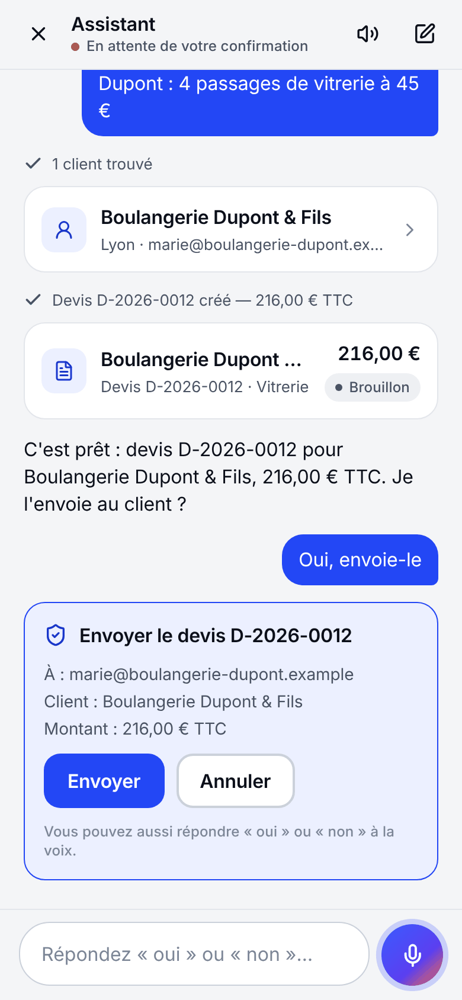

# L'assistant (voix et chat)

L'assistant permet de piloter Aussitôt en quelques mots, dits ou écrits : il comprend la demande, utilise les mêmes actions que les écrans de l'application, montre le résultat dans des cartes et demande confirmation avant tout ce qui engage l'entreprise.

| Demande dictée | Confirmation avant envoi |
| --- | --- |
|  |  |

## Exemples

- « Fais un devis pour la boulangerie Dupont : 4 passages de vitrerie à 45 € » → cherche le client, crée le devis en brouillon, annonce le total TTC et propose « Je l'envoie ? ».
- « Oui, envoie-le » → carte de confirmation (destinataire, montant, PDF) ; l'email part seulement après « Confirmer ».
- « Quelles factures sont en retard ? », « Relance-les » (confirmation pour chaque relance).
- « Transforme le devis D-2026-0012 en facture », « Note un paiement de 300 € par virement ».
- « Planifie Lucas et Emma demain de 8 h à 12 h chez Martin », « Décale la mission de jeudi à 14 h ».
- « Montre-moi le planning de la semaine » → ouvre l'écran.

## Où le trouver

- Téléphone : bouton micro au centre de la barre d'onglets ; appui = dictée, ou saisie au clavier.
- Ordinateur : bouton « Demander à l'assistant » dans la barre latérale ou **Ctrl / ⌘ + K** ; le panneau s'ouvre à côté de l'écran en cours, qui reste visible.
- Accueil : suggestions adaptées au rôle (« Faire un devis », « Factures en retard », « Chiffre du mois »).
- Profil : « Réponses de l'assistant à voix haute » (activé par défaut quand on parle).

## Comment ça marche

```
 app ── texte (dicté ou écrit) ──▶ API /v1/assistant/conversations/:id/messages (flux SSE)
                                     │
                                     ├─ contexte : date et fuseau de l'entreprise, personne, rôle, écran affiché
                                     ├─ outils autorisés pour CE rôle seulement
                                     ▼
                                   Claude (API Anthropic) ─▶ appelle des outils ─▶ services métier de l'API
                                     │                                            (mêmes règles que les écrans)
                                     ▼
 app ◀── texte au fil de l'eau, cartes (devis, factures, missions), demandes de confirmation, écran à ouvrir
```

1. **Dictée** sur l'appareil (`expo-speech-recognition` : reconnaissance vocale d'iOS, d'Android, ou du navigateur — Chrome, Edge, Safari). Le micro n'écoute que pendant l'appui. Le vocabulaire métier (devis, TTC, SIRET, avoir…) est fourni pour améliorer la transcription.
2. **Compréhension et action** côté serveur : le modèle reçoit des consignes stables (mises en cache), le contexte du tour et la liste des outils permis. Il enchaîne au plus `ASSISTANT_MAX_TOOL_ROUNDS` (8) appels d'outils par demande.
3. **Réponse** : texte court (lisible à voix haute : pas de tableau ni de markdown), cartes à l'écran pour le détail, lecture vocale par l'appareil (`expo-speech`) si l'option est active.

Modèle par défaut : `claude-opus-5-5` avec un effort `low` (réponses rapides) ; réglable par `ASSISTANT_MODEL` et `ASSISTANT_EFFORT`. Le code se trouve dans [apps/api/src/modules/assistant](../apps/api/src/modules/assistant) (boucle : `loop.ts`, consignes : `prompt.ts`, outils : `tools/`) et [apps/app/src/assistant](../apps/app/src/assistant).

## Garde-fous

- **Mêmes droits que la personne** : un outil n'est proposé au modèle que si le rôle a la permission correspondante, et le service revérifie tout à l'exécution. Un employé ne peut pas faire émettre une facture par l'assistant.
- **Confirmation obligatoire** pour ce qui sort de l'entreprise ou engage légalement : envoyer un devis ou une facture, émettre une facture depuis un devis, enregistrer un paiement, relancer, annuler (facture par avoir, mission), dupliquer un devis, changer le statut d'un devis, créer, modifier ou annuler une mission. Le modèle ne peut que **proposer** : l'action est enregistrée en attente (`assistant_actions`) et ne s'exécute que sur le bouton « Confirmer » de l'utilisateur. Une proposition non confirmée est abandonnée au message suivant.
- **Pas d'invention** : clients, prix, numéros et dates viennent des outils ou sont demandés.
- **Données ≠ instructions** : les textes saisis par des utilisateurs (noms, notes, emails) sont traités comme des données ; une consigne cachée dedans n'est pas suivie (et resterait de toute façon soumise aux droits et aux confirmations).
- **Changement de droits** : si le rôle de la personne change, la conversation en cours est close (il faut en ouvrir une nouvelle).
- **Traçabilité** : chaque action faite via l'assistant apparaît dans le journal d'activité avec la mention « via l'assistant ».

## Outils disponibles

| Domaine | Outils | Confirmation |
| --- | --- | --- |
| Clients | `search_clients`, `get_client`, `create_client`, `update_client`, `search_sites`, `search_catalog` | — |
| Devis | `list_quotes`, `get_quote`, `create_quote`, `update_quote` | — |
| Devis | `duplicate_quote`, `send_quote`, `set_quote_status` | oui |
| Factures | `list_invoices`, `get_invoice`, `create_invoice` | — |
| Factures | `create_invoice_from_quote`, `send_invoice`, `record_payment`, `send_payment_reminder`, `cancel_invoice` | oui |
| Planning | `get_planning`, `get_mission`, `list_team` | — |
| Planning | `create_mission`, `update_mission`, `cancel_mission` | oui |
| Pilotage | `business_summary`, `open_screen` | — |

Ajouter un outil : `defineTool({ name, description, input: schéma zod, permissions, confirm, label, describe?, run })` dans `tools/*.ts`, en appelant **le service existant** (jamais la base directement), puis l'enregistrer dans `tools/index.ts` et le tester dans `tests/assistant.test.ts`.

## Activation et coûts

- Sans `ANTHROPIC_API_KEY`, l'assistant s'affiche comme non activé ; le reste de l'application fonctionne normalement.
- Quota mensuel par entreprise (`assistantMonthlyQuota`, 3 000 demandes par défaut, 0 = assistant non inclus dans l'abonnement) ; consommation et jetons enregistrés par mois (`ai_usage_months`) pour suivre le coût réel par client et construire les offres.
- Limite de 20 demandes / minute / utilisateur et au plus `ASSISTANT_MAX_CONCURRENCY` (200) réponses générées en parallèle par instance ; une seule demande à la fois par conversation.
- Les consignes et la définition des outils forment un préfixe stable mis en cache par l'API Claude : seules les nouvelles parties de la conversation sont facturées au plein tarif.
- Pour réduire le coût : `ASSISTANT_MODEL=claude-sonnet-5-5` (ou `claude-haiku-5-5` pour les demandes simples), après vérification de la qualité sur des demandes réelles.

## Dictée vocale : prérequis

- **iOS / Android** : la dictée utilise un module natif, absent d'Expo Go. Il faut une version de développement ou une version de test construite avec EAS (voir [DEPLOIEMENT.md](DEPLOIEMENT.md#application-mobile-android-et-ios)). Autorisations micro et reconnaissance vocale demandées au premier usage, avec un texte explicatif.
- **Web** : Chrome, Edge ou Safari (Firefox n'a pas de reconnaissance vocale) ; le micro exige HTTPS (ou `localhost`).
- Selon l'appareil, la reconnaissance peut passer par les serveurs d'Apple ou de Google : à mentionner dans la politique de confidentialité, au même titre que le traitement des demandes par Anthropic.
- Sans dictée disponible, l'app le dit simplement et propose d'écrire.

## Tester sans clé d'API

`tests/visual/demo-server.ts` lance la vraie API (base, permissions, outils, confirmations, emails) en remplaçant seulement le modèle par un scénario : utile pour vérifier l'interface de bout en bout sans appel réseau. Outil de test uniquement, refusé en production.

```bash
cd apps/api && npx tsx --env-file=.env tests/visual/demo-server.ts
```
