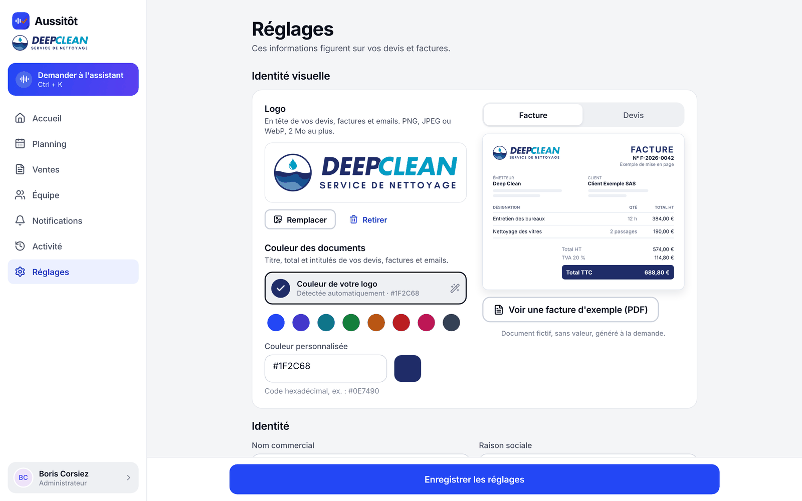
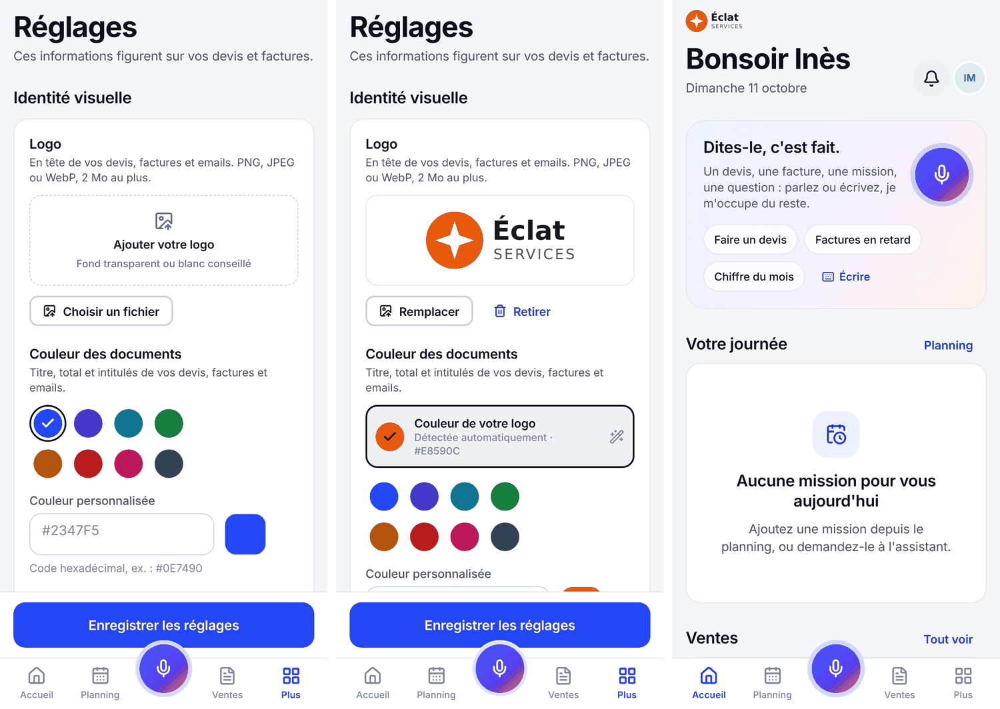
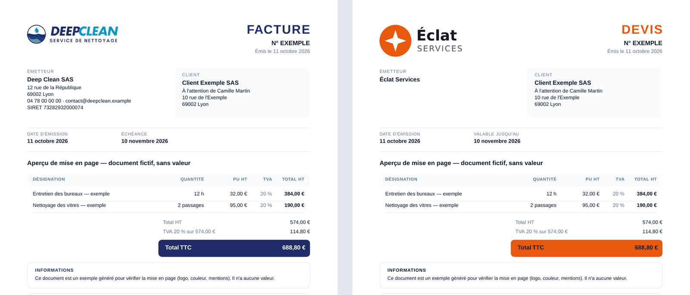

# Identité visuelle de chaque entreprise

Aussitôt garde son nom et son identité ; chaque **entreprise cliente** y injecte la sienne pour ce qu'elle envoie à ses propres clients : son **logo** et sa **couleur** figurent sur ses devis, factures, avoirs, PDF et emails — et seulement les siens.

## Pour l'administrateur du compte

**Réglages → Identité visuelle** (réservé au rôle Administrateur) :

1. **Logo** : toucher la vignette « Ajouter votre logo » (ou « Choisir un fichier ») ; PNG, JPEG ou WebP, 2 Mo au plus, fond transparent ou blanc conseillé. Il est enregistré aussitôt.
2. **Couleur des documents** : la couleur dominante du logo est **détectée automatiquement** et proposée en un geste (« Couleur de votre logo ») ; sinon huit couleurs prêtes à l'emploi, ou un code personnalisé (`#0E7490`).
3. **Aperçu en direct** d'une facture ou d'un devis, avec les montants, le logo et la couleur choisis ; « Voir une facture d'exemple (PDF) » génère un vrai PDF fictif, sans valeur, mis en page par le serveur exactement comme les vrais documents. Les modifications non enregistrées le sont avant l'ouverture de l'exemple.
4. « Enregistrer les réglages ».

« Retirer » supprime le logo des **prochains** documents (après confirmation) ; le nom de l'entreprise s'affiche alors à sa place.

| Téléphone : avant, couleur détectée, accueil | Deux entreprises, deux identités (PDF réels) |
| --- | --- |
|  |  |

## Ce que voit l'équipe

Le logo de l'entreprise apparaît aussi dans l'application : sous le nom Aussitôt dans la barre latérale (ordinateur, tablette) et en tête de l'accueil (téléphone). En mode sombre, il est posé sur un fond blanc pour rester lisible (les logos sont dessinés pour le papier).

## Règles appliquées automatiquement

- **Lisibilité garantie** (contrastes WCAG) : la couleur est utilisée telle quelle pour les aplats (bandeau du total, filet des emails) ; le texte s'adapte — blanc sur une couleur foncée, encre foncée sur une couleur claire, et les titres passent en gris foncé si la couleur est trop pâle sur le blanc. L'écran prévient quand c'est le cas. Toutes les couleurs proposées sont lisibles avec du texte blanc.
- **Logo nettoyé** : décodé puis réencodé en PNG par le serveur, marges vides retirées (il s'aligne au bord du document), taille ramenée à 800 × 400 px au plus, métadonnées supprimées. Le SVG est refusé (il peut contenir du script).
- **Documents déjà transmis inchangés** : un devis envoyé ou une facture émise garde le logo et les coordonnées de ce moment-là, même si le logo est remplacé ou retiré ensuite. Les anciens fichiers de logo sont donc conservés.
- **Confidentialité** : le logo est un fichier privé, servi seulement à l'entreprise connectée ; dans les emails, il est intégré au message (pas de lien vers une adresse publique). Une entreprise ne peut jamais afficher ni recevoir le logo d'une autre (testé).

## Pour les développeurs

| Élément | Emplacement |
| --- | --- |
| Écran | `apps/app/src/features/branding/` (`BrandingSection`, `DocumentMiniPreview`, `CompanyLogo`) |
| Couleurs et contrastes | `packages/shared/src/color.ts` (`readableTextOn`, `brandTextOnWhite`, `BRAND_COLOR_PRESETS`) |
| Données d'exemple communes (aperçu app = PDF) | `packages/shared/src/preview.ts` |
| Import, retrait, aperçu PDF | `apps/api/src/modules/organization/` — `PUT` / `DELETE /v1/organization/logo`, `GET /v1/organization/document-preview?kind=invoice|quote` |
| Couleur dominante du logo | `apps/api/src/lib/logoColor.ts` (colonne `organizations.logoColor`) |
| Mise en page PDF | `apps/api/src/lib/pdf/documentPdf.ts` |
| Emails | `apps/api/src/modules/email/templates.ts` (logo en pièce jointe intégrée `cid:`) |
| Tests | `apps/api/tests/branding.test.ts`, `apps/api/tests/logoColor.test.ts`, `packages/shared/src/__tests__/color.test.ts` |

Le cache des images côté app est indexé par `logoVersion` (nom du fichier, change à chaque nouveau logo) : un nouveau logo s'affiche partout sans redémarrage.
